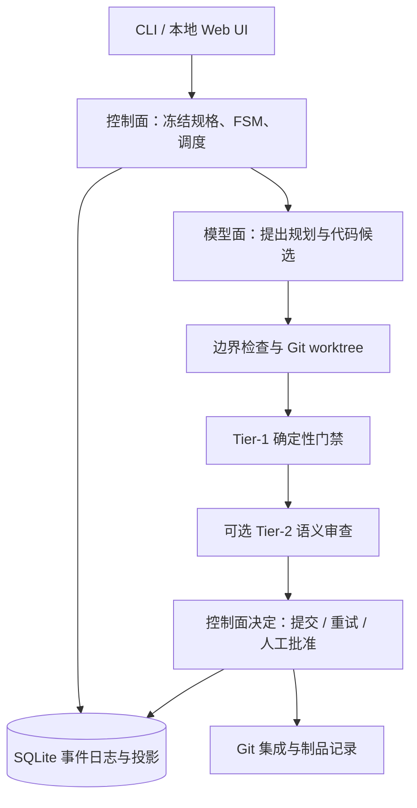

# Daedalus

**面向受监督代码任务的确定性控制平面。** 将模型提出的方案与代码候选，交给明确的规格、执行边界、门禁和事件记录管理，而不是让模型直接决定权威状态。

[快速开始](#快速开始) · [文档](docs/README.md) · [项目导航](PROJECT_INDEX.md) · [参与贡献](CONTRIBUTING.md) · [安全说明](SECURITY.md)

## 项目解决什么问题

代码生成具有不确定性，但任务边界、状态迁移、验收条件和恢复过程不应依赖模型临场判断。Daedalus 将这两部分分开：模型负责提出候选；控制面负责调度、校验、记录、审批与集成。

主要能力：

- **规格与边界**：冻结任务规格及摘要，限制可写路径，保护安全策略与敏感文件；候选文件操作在写入前接受边界检查。
- **有界执行**：DAG 调度、租约、超时、有限重试与并发预算；用 Git worktree 分离任务代码。
- **两层门禁**：Tier-1 执行确定性检查；可选 Tier-2 做语义风险审查，不能推翻 Tier-1 的失败。
- **审计与恢复**：SQLite 事件日志、可重建状态投影、制品引用、备份及重放；中断任务须人工审查并明确继续。
- **本地工作区**：同源 Web UI 与 API，覆盖任务规划、节点状态、门禁、审计、人工批准和模型设置，无需单独构建前端。
- **可配置模型与检索**：规划、编码、审查角色可分别配置；支持多种文本生成协议，以及只读项目记忆和按需检索。

### 使用边界

Daedalus 适合在**可信仓库中受监督使用**，不是无人值守交付保证。门禁通过只表示已配置检查通过，不代表代码正确、无漏洞或获得形式化证明；模型审查也不是独立事实来源。

Git worktree 不是强安全沙箱。实际进程隔离取决于系统及可用驱动，`host-process`、macOS Seatbelt 与容器的能力不同。请先运行 `preflight` 并阅读 [安全说明](SECURITY.md)，不要用真实凭证或敏感主机测试不可信代码。回滚不撤销第三方系统中的外部副作用。

## 快速开始

### 环境与源码安装

需要 **Python 3.12 或更新版本**、**Git**，以及允许创建 worktree 和本地 SQLite 文件的目录。macOS 的钥匙串保存和 Seatbelt 是平台相关功能；其他系统不能假定具有相同能力。

取得本仓库源码后，在仓库根目录执行：

```bash
python3 -m venv .venv
source .venv/bin/activate
python -m pip install -e '.[dev]'
daedalus --help
```

Windows 可使用 `.venv\Scripts\Activate.ps1` 激活环境。安装依赖通常需要网络；这不表示后续离线演示需要模型服务。本指南从源码安装，不依赖预先发布的 wheel 或同名 PyPI 包。

### 离线演示

```bash
daedalus demo
```

演示在临时目录创建 Git 仓库、SQLite 事件库和门禁，使用**脚本化 Worker** 展示合法修复、越界拒绝、有界重试、语义审查、并发集成、重放和人工批准等控制流程。它不需要 API Key，也不证明真实模型的编码能力。可通过 `daedalus demo --help` 查看场景选择与保留工作区选项。

### 启动本地 UI

显式创建独立工作区配置，再以前台方式启动服务：

```bash
daedalus init --path daedalus.toml --workspace ./.daedalus
daedalus preflight --config daedalus.toml
daedalus serve --config daedalus.toml --host 127.0.0.1 --port 13475
```

打开 <http://127.0.0.1:13475>。`daedalus.toml`、运行数据库、日志、备份和 worktree 是本机运行资料，不应提交到 Git。不要将监听地址随意改为公网地址。

需要托管启停和交互控制台时，可使用 `daedalus --config daedalus.toml --open`；详见 [终端与服务控制](docs/service-control.md)。启动或恢复模型连接不会自动继续中断任务。

## 配置模型

离线演示不需要模型。接入真实模型时，在本地 UI 的「模型设置」中选择协议、填写账户可用的模型 ID，并为规划、编码、审查分配连接。支持 OpenAI Chat Completions、Responses、Anthropic Messages 和 Gemini 文本协议；预设不代表所有模型、套餐或网关均已验证兼容。

**不要把密钥写进命令行、shell 历史、提交文件、Issue 或截图。** 推荐在本机 UI 输入，或由受信任的启动环境/密钥管理器提供环境变量。配置文件只记录变量名，例如：

```toml
[model.coder]
provider = "openai"
api_format = "openai_chat"
base_url = "https://api.openai.com/v1"
model = "填写账户可用的模型ID"
api_key_env = "DAEDALUS_CODER_KEY"
```

将该段合并到初始化生成的配置中，保留其他设置；环境变量由服务进程的启动环境提供，不要使用包含真实密钥的 `export` 示例。网页导出不包含密钥值，但模型地址、名称等元数据仍应在分享前审查。

macOS 支持把连接凭证绑定保存到系统钥匙串；其他系统的安全保存不可用时会报错，不会退回明文保存。凭证仍会在后端进程内存中使用，无法防御已控制该账户或进程的攻击者。远程模型会接收任务所需的仓库上下文，请先确认代码与数据允许发送。

详细操作见 [模型接入](docs/model-settings.md) 与 [凭证保存边界](docs/model-credential-storage.md)。CLI 的 `run --model` 是 OpenAI 兼容快捷入口；不指定模型时只做规划与边界校验，不会生成代码。

## 架构概览



模型面与执行面均不被当作可信决策者。状态迁移由领域状态机约束，应用层组织流程，基础设施层承担 Git、SQLite、进程和网络副作用。事件日志是状态事实来源；重放与制品复用仍需满足摘要和门禁条件。

## 文档与开发

- [文档索引](docs/README.md)：架构、设计差异、运维、模型、检索和路线图。
- [项目导航](PROJECT_INDEX.md)：源码分层与常用入口。
- [贡献指南](CONTRIBUTING.md)：离线测试、信任边界及安全测试数据。
- [安全策略](SECURITY.md)：部署前提、凭证限制及漏洞报告方式。

开发环境安装后，在仓库根目录执行：

```bash
python -m pytest
python -m ruff check src tests
python -m build
```

默认测试不调用真实模型或要求真实凭证；部分测试会启动本机假 HTTP 网关，需要本机监听权限。容器和 Seatbelt 检查取决于宿主能力，不能把跳过视为验证通过。真实模型调用必须单独、明确地选择，避免产生意外费用或发送私有代码。

## 许可与来源

本项目采用 [MIT License](LICENSE)，软件按原样提供，不作担保。

Daedalus 的设计及部分选择性移植参考了同为 MIT 许可的 [AgentPanelX](https://github.com/aowo-1345/AgentPanelX)。这不是“完全从零实现”的声明；具体继承、改写与未复用部分见 [来源与差异记录](docs/agentpanelx-reuse.md)。第三方资源应保留各自的许可与来源声明。
