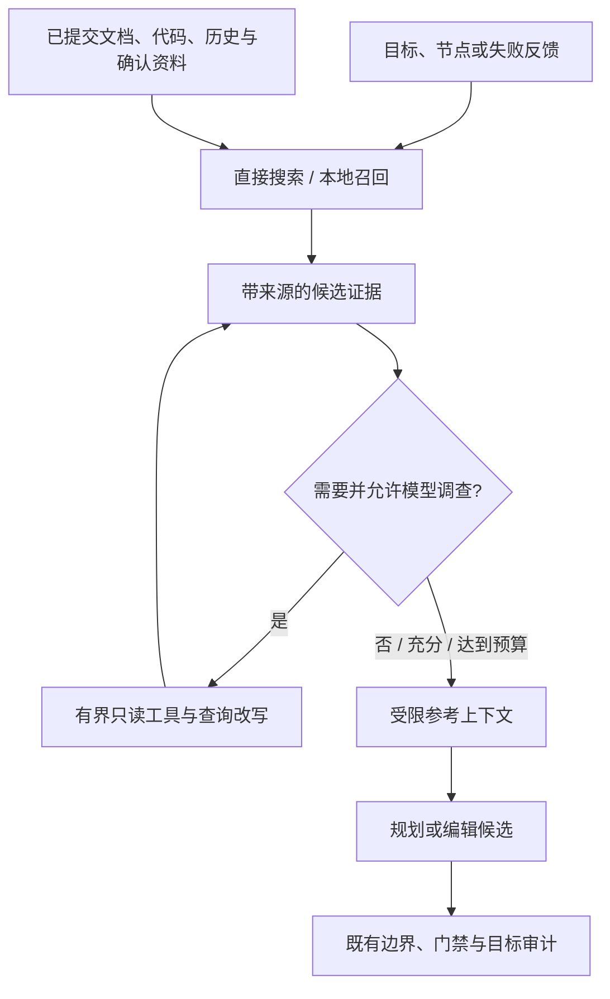

# 项目记忆与 Agentic RAG

检索为规划、故障定位和代码候选提供可追溯上下文，不替代任务目标、执行边界、确定性验收或人工审批。系统先使用低成本搜索，缺少证据时再进行有界补查；当前召回、混合排序与调查策略见 [按需检索](retrieval-strategy.md)。

## 数据与信任边界

| 来源 | 范围 | 引用依据 |
| --- | --- | --- |
| 项目文档 | 当前仓库已提交的 Markdown / 文本；不读取未提交版本或符号链接 | commit、路径、分块摘要 |
| 代码定位 | 已提交代码的搜索结果、读取窗口与符号信息 | commit、路径、行范围、摘要 |
| 历史事件 | 同一仓库的执行失败、门禁决策、目标审计和完成记录 | event ID、摘要 |
| 用户资料与偏好 | 用户明确确认保存、按项目隔离的文本 | knowledge ID、摘要 |

历史事件只是历史事实，上次通过不能充当本次通过。资料和偏好是**不可信参考**，不能扩大写入范围、替换验收条件或授予工具权限。出站扫描用于降低凭证泄漏风险，但不是完备的秘密检测；远程模型可能接收这些上下文，使用前应确认资料允许外发。

资料保存在工作区 `knowledge/`，与权威事件库分离。检索轨迹保留近期记录及引用快照；删除资料影响后续上下文，不追溯改写已保存的历史审计。检索索引是可重建投影，不是新的状态事实来源。

## 处理流程

调查可使用 `search`、`grep`、`read`、`expand`、`follow_link`、`symbol` 与 `finish`。工具只返回受限范围内的证据，不能把检索请求当作文件修改。没有新证据、预算不足、控制模型不可用或动作无效时会停止额外调查。

模型选择的引用必须来自实际候选；不存在、跨范围或无法对应当前语料的引用不被当作有效来源。最终参考上下文限制在约 6000 字符内，检索控制调用计入任务预算。模型精排失败时退回真实的粗排候选，而不是编造结果。

## 使用方式

在任务工作区的「项目记忆与决策依据」面板中，可查看当前项目的资料和偏好、确认保存文本、删除资料、执行试查及查看近期引用。切换任务后按当前项目重新加载，避免将旧请求结果显示为新项目内容。

| 接口 | 用途 |
| --- | --- |
| `GET /api/knowledge?repo_path=…` | 当前项目资料与近期检索记录 |
| `POST /api/knowledge` | 保存资料或偏好，必须明确 `confirmed=true` |
| `DELETE /api/knowledge/{id}?repo_path=…` | 删除项目资料或偏好 |
| `POST /api/knowledge/retrieve` | 试查，`use_model` 默认 false |
| `GET /api/runs/{run_id}/knowledge` | 按任务实际仓库查找项目资料和记录 |

近期记录是项目级视图，不能声称每条轨迹都精确归属于当前任务；规划阶段可能尚无 run ID，执行阶段可携带已有 run 上下文。试查默认不使用生成模型，只有明确允许后才进行相应调查或精排。

## 范围与限制

- 文档、历史、用户资料和总分块数均有数量及大小上限，不保证覆盖整个仓库；空结果应如实展示。
- 本地语义检索为可选依赖，须准备模型及项目索引；不可用状态与词法搜索不是同一种能力。
- 不联网抓取外部页面，不解析任意 PDF，不建立跨用户画像，也不训练模型。
- 引用有效只表示可追溯，不表示其内容正确；检索命中和排序质量不等于最终代码质量。
- 知识目录需单独备份。数据库备份不自动覆盖资料、向量索引或系统钥匙串；详见 [运维手册](runbook.md)。
- 检索、重新开启服务和恢复模型连接均不自动继续中断任务。

实现入口为 `src/daedalus/application/agentic_rag.py`、`src/daedalus/infrastructure/knowledge.py` 和 `src/daedalus/service/knowledge_routes.py`。这些功能没有新增绕过 FSM、审批或制品复用条件的通道。
