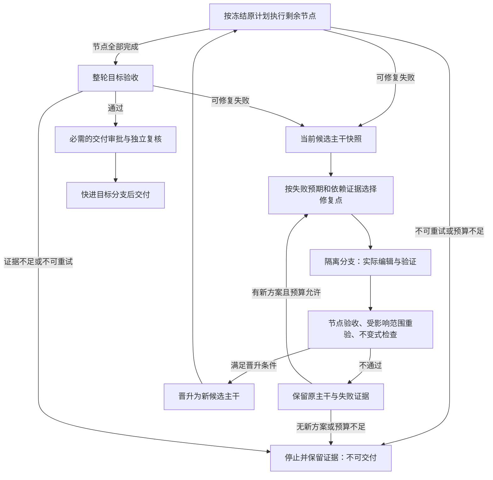

# Daedalus 架构

Daedalus 是面向 Git 仓库的受监督工程执行系统：模型提出计划、编辑和审查候选，控制面负责冻结契约、调度、边界检查、门禁、提交及审计。本文描述当前代码的职责与限制，不将摘要、测试通过或模型审查等同于形式化证明，也不构成生产就绪声明。

## 1. 信任边界与分层

| 层次 | 主要模块 | 权限与职责 |
| --- | --- | --- |
| 领域契约 | `domain/` | 定义规格、状态机、事件、制品和审批数据，不承担外部 I/O |
| 控制面 | `application/`、`security/` | 校验模型候选，管理租约、配额、审批、门禁和交付流程 |
| 基础设施 | `infrastructure/` | 实现 SQLite、Git worktree、子进程、隔离驱动、脱敏和凭证存储等副作用 |
| 模型适配 | `model/` | 通过统一协议调用模型；模型返回内容始终是不可信输入 |
| 用户接口 | `cli.py`、`service/` | 将终端、HTTP 和网页操作交给应用服务，不另建状态迁移规则 |
| 执行面 | Worker 工作区及仓库命令 | 产生待审查代码、命令结果和文件，不获得控制面或审批权限 |

应用层组合领域与基础设施；领域不依赖上层。Planner、编码 Worker 和语义 reviewer 的输出只表示建议，不能直接成为合法状态、扩大白名单或批准自己的改动。

这里的“可信”指威胁模型中的信任前提，不表示控制面无缺陷。系统依赖可信的服务账号、控制面进程、操作系统和持久化存储；事件追加约定不提供抵抗恶意数据库管理员篡改的保证。

## 2. 冻结规格与权限

[规格模型](../src/daedalus/domain/spec.py) 将任务拆为四份文档：

- **SPEC-01 / Goal**：目标、风险、不可破坏条件及验收标准。
- **SPEC-02 / Plan**：经 DAG 校验的节点、依赖、预期制品与尝试策略。
- **SPEC-03 / Boundary**：可写路径、工具、网络、依赖与资源限制。
- **Meta-Spec**：系统自身不得自行放宽的保护边界。

统一摘要绑定这些文档的内容和版本关系，但摘要不是身份认证或授权。规格签批与步骤级人工决定由独立审批服务处理。高风险任务需要相应规格批准；`CRITICAL` 步骤不能仅凭模型同意自动提交。

Meta-Spec 默认保护领域、应用、安全、模型、基础设施等控制代码及门禁测试。规划加固与执行前守卫分别收窄和检查范围；`allow_gatekeeper_self_modification` 与 `allow_control_plane_self_modification` 必须保持 `False`。普通任务不能通过修改自己的规格解除这些限制。

## 3. 状态机与事件存储

### 3.1 步骤与运行生命周期

[状态机](../src/daedalus/domain/fsm.py) 是合法迁移的唯一声明位置。主要步骤路径为：

```text
PENDING → READY → LEASED → RUNNING → AWAITING_GATEKEEPER
        → TIER1_PASSED → APPROVED → COMMITTING → COMMITTED
```

`TIER2_REVIEWING` 也是状态枚举成员；实际迁移以事件表及事件载荷中的 `outcome` 为准，不能据示意图跳过门禁。失败、修订、超时、租约丢失、失效及升级分别由 `FAILED`、`REVISE`、`TIMEOUT`、`LOST`、`STALE`、`ESCALATED` 等状态表达。

`COMMITTED`、`CANCELLED`、`SUPERSEDED` 是步骤终态。重放建立新的执行身份，不重新打开原终态。`REVISE` 可以在策略允许的剩余尝试内再次获取租约。

运行状态包括 `PENDING`、`RUNNING`、`AWAITING_APPROVAL` 和最终的 `COMPLETED`、`PARTIAL_FAILURE`、`FAILED`、`CANCELLED`。等待人工处置不是交付成功。

### 3.2 持久化顺序

[状态迁移服务](../src/daedalus/application/fsm_service.py) 先检查冻结摘要、执行归属和 FSM 前置条件，再在 SQLite 事务中完成：

```text
追加事件 → 更新状态投影 → 写入时间线及相关指标
```

[事件存储](../src/daedalus/infrastructure/store/event_store.py) 的事件日志是运行状态的权威记录。运行、步骤、租约、制品、门禁、执行者等表提供查询投影；身份登记和配置另有各自的管理约束。事件序号具有唯一性约束，并可检查连续性。

幂等键包含执行、步骤和操作身份，用来记录操作占用及已完成结果。步骤提交收据将 `StepCommitted`、运行级提交事件、步骤状态、制品提交元数据、门禁引用、后继基线、租约释放及幂等结果放入同一 SQL 事务。

**SQL 事务不覆盖 Git。** Git 提交或 ref 更新可以先于 SQL 收据持久化；不能因此宣称跨 Git/SQLite 的原子事务或任意崩溃下的恰好一次执行。受限对账见第 9 节。

## 4. 调度、并发与预算

[Scheduler](../src/daedalus/application/scheduler.py) 检查依赖是否已提交、步骤状态与执行身份是否可激活、是否持有有效租约及资源准入条件，并记录不可运行的原因。刷新阶段还处理摘要漂移、租约过期、重试、升级和失败传播。

- 租约到期可使 `LEASED` 或 `RUNNING` 转为 `LOST`，再按恢复与重试策略处理。
- `lease_id` 与到期时间应同时存在或同时清空；终态清理租约，但保留执行者溯源。
- 重试受尝试次数及错误分类约束。确定性验收失败可以把反馈交给新的修复候选；边界、权限、摘要等不可重试错误不会靠反复调用模型解决。
- 上游失败可通过下游闭包标记不可达节点，避免继续执行已失去前提的工作。

[编排器](../src/daedalus/application/orchestrator.py) 串行管理租约、门禁、收据与集成，只让不可信 Worker 在独立 worktree 中并发执行。模型调用的用量回调有独立同步；“控制面串行”不表示模型没有并发或所有文件写入都在同一线程。

[TokenBudget](../src/daedalus/model/base.py) 维护运行累计账本和 `(step_id, attempt)` 作用域。请求发送前在锁内检查已报告用量与在途预留，响应后结算实际 usage，异常时释放预留。新尝试有新的步骤额度，但不清空运行累计值；显式恢复重建已有记录中的用量。

输入估算误差、供应商未报告 usage、传输故障及强杀后的记账窗口仍可能造成账单与本地记录不同。该预算是本地请求准入控制，不是供应商费用硬上限，也不在额度竞争时自动排队。

## 5. 工作区与 Git 集成

[WorktreePool](../src/daedalus/application/worktree_pool.py) 为运行建立集成分支，并为步骤分配工作区。步骤通过门禁后先集成到运行分支；部分失败保留已完成的提交，但不据此推进目标分支。

```text
目标分支基线
  └─ 运行集成分支
      ├─ 步骤 A：执行 → 门禁 → 提交
      └─ 步骤 B：执行 → 必要时重基 → 重新门禁 → 提交
           └─ 完整目标审计 / 必需的独立复核 → 目标分支快进
```

[GitSandbox](../src/daedalus/infrastructure/git_sandbox.py) 从明确提交创建 worktree，检查路径是否解析在工作区内，并以 compare-and-swap 更新受管 ref。集成要求快进，不通过强推解决冲突。

并发候选基线落后时需要重基；重基后的树必须生成新制品并重新通过门禁，不能挪用旧树的批准。重基冲突进入修订流程，而非覆盖其他步骤结果。最终发布还要核对目标分支前提和获批的精确集成提交。

## 6. 执行隔离、依赖与凭证

### 6.1 隔离驱动

[驱动选择](../src/daedalus/infrastructure/sandbox/probe.py) 依据实际探测与 Boundary 策略选择机制。显式要求的隔离级别不可用时拒绝，不静默降级；`auto` 也只能选择能满足其选择规则的可用机制。

| 驱动 | 已实现机制 | 必须保留的限制 |
| --- | --- | --- |
| `host-process` | worktree、净化环境、部分 rlimit、超时与所属进程组清理 | 不提供内核级文件系统、网络或进程隔离；命令仍以服务账号权限运行 |
| `seatbelt` | macOS Seatbelt profile，限制写入范围并支持运行期禁网 | 依赖平台与运行环境；不提供宿主读取保密，也不能表达域名 allowlist |
| `container` | 容器启动策略、只读根、受限挂载、权限与网络参数、定向回收 | 依赖可用运行时与镜像；参数和可用性探测不是逃逸防护、完整资源配额或崩溃清理的部署验收 |

[子进程管理](../src/daedalus/infrastructure/process.py) 使用独立会话和进程组处理超时及普通后代清理。host/Seatbelt 的部分 rlimit 不等于任务级总内存、CPU 使用率或总磁盘配额。不能把门禁期命令检查说成运行期网络强制隔离；域名级网络 allowlist 仍是缺口。

### 6.2 依赖完整性

路径守卫要求依赖 manifest 与锁文件成对变化，并限制安装类命令。[离线依赖校验](../src/daedalus/application/dependencies.py) 进一步检查受支持的 Python 声明、精确版本与 SHA-256 锁、操作员内容缓存、wheel 元数据、RECORD 及传递依赖。

该校验不下载、不安装、不执行依赖代码；其他生态的完整性验证不因识别了文件名就自动受支持。哈希只证明内容对应，不证明发布者可信、无漏洞或实际运行环境已经安装同一制品。详见[依赖完整性](dependency-integrity.md)。

### 6.3 密钥与审批身份

[Secret Broker](../src/daedalus/security/secrets.py) 管理有时效和范围的授权；[出站检查](../src/daedalus/security/outbound.py) 对检测到的敏感内容拒绝发送，而非替换后继续请求。[脱敏模块](../src/daedalus/infrastructure/redact.py) 处理事件、日志和导出边界；这些机制不能替代操作员对待处理仓库的保密审查。

扫描器区分 Python 属性读取与凭证字面量，避免把 `secret=self.secret` 等计算引用当成硬编码密钥；含字面量的后备表达式仍拒绝。完整且限长的 JSON 行先解码内部字符串再检查，不能借编码隐藏字面量。该语法判别不是凭证来源证明，零告警仍不代表没有泄密。

[身份服务](../src/daedalus/application/identity.py) 校验登记、角色、撤销状态及用途隔离的 HMAC-SHA256 签名。规格审批绑定冻结摘要，步骤决定绑定运行、步骤、决定、制品及尝试。无身份登记且未强制身份的开发工作区可记录未核验审批，必须显示其未核验性质；一旦登记或策略要求身份，不能因遗漏参数或撤销最后一个主体退回宽松模式。

HMAC 使用共享密钥，不提供第三方不可否认性；控制面和密钥管理仍受信任。模型连接的临时凭证保留在内存；显式安全保存通过 macOS Keychain 存储凭证及连接绑定，工作区保存连接参数、引用和指纹。详见[凭证存储](model-credential-storage.md)。

## 7. 门禁、目标审计与交付复核

### 7.1 步骤门禁

[门禁流水线](../src/daedalus/application/gatekeeper/pipeline.py) 始终先运行 Tier-1。其检查覆盖路径、diff、依赖配对与离线完整性、规格和制品关系、语法、已配置的 linter/typecheck、资源、预期文件、禁止文件、敏感内容与可执行验收。依赖完整性失败会阻止依赖候选环境的相关命令继续执行。

Tier-1 不通过时不调用 Tier-2。Tier-2 只能使结论更保守，不能覆盖确定性失败。[语义审查契约](../src/daedalus/application/gatekeeper/tier2.py) 绑定审查主体，要求合法决定、证据和置信度；解析失败、主体不符、矛盾输出或传输异常均停止，不生成可人工覆盖的批准请求。

语义审查展示最多 1800 字符的 Worker 执行日志首尾，明确视为不可信陈述而非测试证据；完整日志摘要参与审查主体身份，截取前先扫描整份日志中的凭据。单步与整轮审查均限制完整 diff 不超过 24000 字符，超限时不调用语义模型且不交付，不能对仅展示前缀的 diff 自动批准。这是保守覆盖限制，不表示交付能力提高。

无 reviewer 的 LOW/NORMAL 路径允许仅凭确定性门禁推进，并明确记录跳过语义审查；高风险缺少 reviewer 时停止。即使 reviewer 同意，`CRITICAL` 的提交前执行授权仍是强制前提；HIGH/CRITICAL 的规格执行授权也不后移。普通编码或验收失败不是授权请求，人工继续不能绕过安全、隔离或证据前提。

### 7.2 整轮目标审计

[Goal Audit](../src/daedalus/application/goal_audit.py) 在启用该策略的运行中，于目标分支推进前检查集成结果与原始目标：重新执行原始可执行验收，存在 reviewer 时再进行逐项语义判断。只通过可执行验收时标记 `acceptance_only`；未知、缺失或矛盾证据不能冒充语义批准。

初始执行之后，单步修复与整轮目标修复在同一 execution 下共用最多两个隔离修复分支；拒绝分支也消耗额度，原单步尝试上限继续生效。整轮目标最多三个 stage，不能靠进入子运行重置分支、token 或调用额度。根 Goal、Boundary 与 Meta-Spec 始终冻结；局部子运行只投影选中节点、受影响节点及已通过目标项的原始验收定义，不能将局部完成冒充原目标完成。子运行只交付到私有暂存 ref，候选主干仅在精确版本验证通过后快进；最终发布仍必须通过完整原目标审计和必需的独立复核。高风险新子规格仍需自己的批准，中断历史不隐式重开。

#### 低开销候选主干与修复分支

正常路径只追加 `TrunkExpectationsFrozen` 和已有门禁的 `TrunkNodeValidated/Failed` 证据，不增加模型评分调用。单步可修复失败直接进入独立 attempt worktree，在复位前记录失败补丁、候选树和门禁证据；失败工作树本身可能随后复位。以该节点的冻结产物范围约束修复，保留当前候选主干。整轮目标失败则按具体 UNMET 收据归属原节点。未知、环境故障或归属歧义不能用最低分猜测修复点。

选择优先处理有明确失败证据的上游依赖，其次比较受影响范围，再以逆拓扑顺序打破同等条件。影响范围包含下游闭包和共享产物节点；修复验证保留该范围的冻结检查以及已经通过的原目标检查。相同基线、补丁和观测证据的已拒绝候选不再重复购买语义审查；新基线或新证据仍可接受验证。失败反馈优先携带实际错误和当前源码，而非投影中残留的通过摘要；源码定位优先原任务符号，任务无法定位时才回退到旧锚点中实际存在的符号，窗口仍为 2400 字符。

语义重试同时传递必需修改和详细代码推演理由，明确推演不是实际执行证据；下一次编码使用当前已接受基线，不能把被拒补丁当成当前源码。重试源码窗口结合失败位置，语义审查在原有 3200 字符候选源码上限内补充局部调用方和参数生产者；解析仅保守识别同类中的简单赋值与调用，不是完整调用图或可达性证明。整份源码仍先做出站检查，遗漏区域继续明确标记。该调整不新增模型调用，也不把没有证据的推测自动变成批准。

源码窗口压缩长 docstring 时优先保留关闭符、后续注释和首条语句的连续锚点，避免编辑必须重建已省略的原文。消费者与参数生产者同时出现在查询中时，仍按局部赋值关系为生产者分配窗口，不能假定被查询就已经可见；两者均受原有字符上限约束。

修复工作记忆通过 `WorkerContext.repair_memory` 确定性组装，不依赖一次检索是否命中：读取同一运行跨 execution 的失败，以及规格中显式冻结、且 Goal、节点与产物范围匹配的父任务历史。保留候选树、补丁摘要、历史已通过项和失败项；执行检查失败与审查假设分别标注，后者不是新增需求。最多保留 8 条、约 6000 字符的记录内容，截断时显式标记省略数量，不能把省略当作问题已解决。普通首次执行不为此扫描运行历史；重试、恢复或显式带入谱系时才组装，不增加模型调用。

这层记忆只指导编辑，不改变当前验收、审批、预算或晋升结论。新运行、克隆仓库或不同目标不会无条件共享历史；跨任务关联必须显式冻结。持久日志、项目知识检索和模型请求上下文是三层机制，存在存储不等于每次请求都读到了完整历史。



各分支复用原 TokenBudget、调用方费用准入及累计用量，保留最终语义审查预留；这仍是本地估算，不是供应商费用硬保证。失败的补丁摘要、脱敏预览和验收收据在工作树复位前保留，拒绝分支不改变候选主干。晋升后从新主干继续，不能回到初始代码丢掉已验证的修复。冻结证据只证明已覆盖行为，不保证需求完整或未知依赖已被发现。

普通修复耗尽、预算不足、模型用量不明、越界或无法证明的验收结论以 `FAILED/PARTIAL_FAILURE` 结束。整轮目标通过 `stop_reason` 给出停止原因，单步保留 `last_failure` 与结构化失败事件，不伪装成待审批。审批 API、队列、路线图与节点操作共用已记录的强制执行授权判定，不因节点仍为 `ESCALATED` 就开放人工继续/重试。服务关闭断点仍需显式恢复审查，不自动执行。

### 7.3 独立交付复核

[独立复核服务](../src/daedalus/application/independent_validation.py) 只在完整原目标验收通过、有精确可用候选后请求交付复核。服务新任务默认将 HIGH/CRITICAL 纳入该策略；显式配置的非 CRITICAL 单步人工级别统一后移为最终交付复核，并自动启用完整目标审计，局部修复子运行不提前请求普通交付复核。旧任务不追溯改写；规格签名、身份与职责分离前提不放宽。

复核检查执行归属、提交、证据新鲜度、角色、签名和职责分离；不能由原规格或步骤继续/重试的批准主体换个名称重复签署。显式恢复重新核对批准与提交，不借此开启新的修复轮次。该流程仍在同一可信控制器上，不能证明实际人员或硬件环境独立。

## 8. 制品复用与重放

[ArtifactCache](../src/daedalus/application/artifact_cache.py) 要求节点规格、代码基线、依赖、工具链和输入制品五路摘要全部匹配，且来源已提交并能指向批准门禁。编排器还检查实际提交可用性和集成前提。缺少来源的 `StepCacheHit` 不能把步骤直接变成已提交。

节点摘要用于避免不相关 Plan 变化使所有节点失效，不替代整份规格的执行摘要。[重放服务](../src/daedalus/application/replay.py) 记录新执行与父执行关系，提供目标破坏性、局部计划和边界变化分类及受影响闭包。按提交重放与制品复用已存在；“任意规格变化后自动只调度失效子图”不是已接通的通用入口，不能把 `STALE` 标记等同于完整增量执行。

回滚追加历史，不删除事件；它也不等于自动撤销已经发布到目标分支的 Git 历史。

## 9. 崩溃恢复与服务生命周期

[提交对账](../src/daedalus/application/commit_recovery.py) 仅为已经集成、且与提交意图、当前门禁、审查树、规格及执行完全对应的 Git 事实补齐缺失 SQL 收据。交付对账只在目标已经等于获批提交时补记完成，不创建提交、重基或推进 ref。旧式、不完整、重基或人工 override 等超出自动对账条件的情形保留人工处理要求。

[仓库锁](../src/daedalus/infrastructure/repository_lock.py) 使用 Git common directory 上的 POSIX 文件锁，互斥同一仓库的执行控制器和修复操作。这是单机协调机制，不是分布式锁。

[服务生命周期](../src/daedalus/application/service_lifecycle.py) 区分服务重启与任务恢复：正常停止发送协作信号，在步骤批次边界停车，保留规格、收据及工作区；启动仅报告未完成任务并生成提醒，不自动派发 Worker。人工恢复审查绑定当前证据和集成提交，显式恢复仍受原预算、审批、仓库锁及门禁约束。详见[服务控制](service-control.md)与[运行手册](runbook.md)。

## 10. 交互、检索与审计

- **任务澄清**：[Intake](../src/daedalus/application/intake.py) 只读扫描后提出结构化问题，限制模型可决定的字段；控制面补足可写范围问题，人的选择进入规划请求，冻结后加固只收窄边界。要求模型参与的入口不会把模型不可用伪装成模型已完成规划。
- **上下文检索**：[按需检索控制器](../src/daedalus/application/agentic_rag.py) 组合受限只读工具和混合召回。检索内容只提供上下文，不授予写入、网络或审批权限；向量与精排可用性不等于相关性或任务质量保证。详见[检索策略](retrieval-strategy.md)。
- **冻结行为验收**：[需求证据服务](../src/daedalus/application/requirement_evidence.py) 与[显式本机 API](../src/daedalus/service/requirement_routes.py) 可将操作员用例、需求映射、干净基线及范围绑定为收据，再显式用于新任务。未澄清、已满足或执行不完整不能凭收据启动修复。当前依赖 Seatbelt，网页 intake 和未绑定收据的入口不自动获得这层保障；受控用例也不证明覆盖全部需求或抵抗任意 Python 内省攻击。
  已绑定用例的 Worker 只接收本节点适用的冻结验收，展示需求、用例、change/invariant 角色、基线结果及操作员冻结源码；不把终态行为用例提前施加到局部节点。快照按 `requirement_id/test_name` 展示检查状态，同时保留原聚合验收作为晋升门禁；收据不完整或摘要不符时阻断修复选择，不制造可修复失败。没有对应行为用例的回归通过仍只表示已覆盖断言通过，不能自动补出未知需求，也不能使用隐藏评分用例作为修复反馈。
- **控制台**：服务端模板与原生 JavaScript 展示规划、执行、审计和人工处置，前端资源随源码提供，不依赖运行期 CDN。操作指南见[工作台](ui-workspace.md)。
- **审计**：事件、制品、门禁、审批、时间线、指标及因果标识用于回答发生了什么。[执行日志引用](../src/daedalus/application/execution_log.py) 解析持久化记录，不以空结果掩盖未知引用；[评分](../src/daedalus/application/scoring.py) 汇总证据覆盖，不是代码正确率或上线许可。

## 11. 发布边界

[发布门禁](../src/daedalus/application/release_gate.py) 默认使用 production 模式，要求必需检查齐全且全部为 PASS；WARN、SKIP 或缺项都会阻断。development 模式仅供诊断。

当前运行期安全证据与依赖运行环境证据检查在代码中仍为 SKIP，因此不能据现有功能宣称生产门禁已通过。可用性探测、脚本化示例、模型批准和审计评分均不能替代部署验收。剩余工作见[路线图](roadmap.md)，与规格文字的实现取舍见[设计决策](design-decisions.md)。
