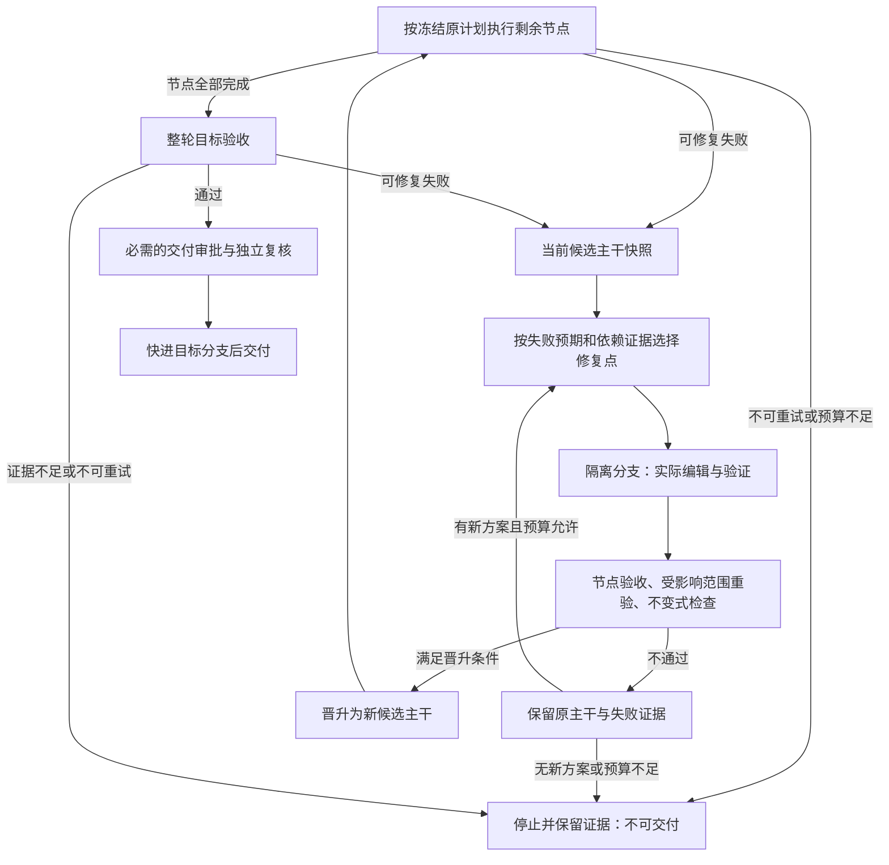

# Daedalus 架构

Daedalus 是面向 Git 仓库的受监督工程执行系统：模型提出计划、编辑和审查候选，控制面负责冻结契约、调度、边界检查、门禁、提交及审计。本文描述当前代码的职责与限制，不将摘要、测试通过或模型审查等同于形式化证明，也不构成生产就绪声明。

## 1. 信任边界与分层

| 层次 | 主要模块 | 权限与职责 |
| --- | --- | --- |
| 领域契约 | `domain/` | 定义规格、状态机、事件、制品和审批数据，不承担外部 I/O |
| 控制面 | `application/`、`security/` | 校验模型候选，管理租约、配额、审批、门禁和交付流程 |
| 基础设施 | `infrastructure/` | 实现 SQLite、Git worktree、子进程、隔离驱动、脱敏和凭证存储等副作用 |
| 模型适配 | `model/` | 通过统一协议调用模型；模型返回内容始终是不可信输入 |
| 用户接口 | `cli.py`、`service/` | 将终端、HTTP 和网页操作交给应用服务，不另建状态迁移规则 |
| 执行面 | Worker 工作区及仓库命令 | 产生待审查代码、命令结果和文件，不获得控制面或审批权限 |

应用层组合领域与基础设施；领域不依赖上层。Planner、编码 Worker 和语义 reviewer 的输出只表示建议，不能直接成为合法状态、扩大白名单或批准自己的改动。

这里的“可信”指威胁模型中的信任前提，不表示控制面无缺陷。系统依赖可信的服务账号、控制面进程、操作系统和持久化存储；事件追加约定不提供抵抗恶意数据库管理员篡改的保证。

## 2. 冻结规格与权限

[规格模型](../src/daedalus/domain/spec.py) 将任务拆为四份文档：

- **SPEC-01 / Goal**：目标、风险、不可破坏条件及验收标准。
- **SPEC-02 / Plan**：经 DAG 校验的节点、依赖、预期制品与尝试策略。
- **SPEC-03 / Boundary**：可写路径、工具、网络、依赖与资源限制。
- **Meta-Spec**：系统自身不得自行放宽的保护边界。

统一摘要绑定这些文档的内容和版本关系，但摘要不是身份认证或授权。规格签批与步骤级人工决定由独立审批服务处理。高风险任务需要相应规格批准；`CRITICAL` 步骤不能仅凭模型同意自动提交。

### 2.1 生成任务的局部验收与整体验收

模型规划按可独立验收的改动拆分，而不是按文件数或固定步骤数拆分。每个节点声明具体目标、唯一写入的产物、直接依赖和局部测试；共同实现一个不可独立验证的行为可以留在同一节点。没有依赖的节点保留为并行根，只有消费者才等待生产者提交。规划失效时只允许一次结构纠正；不具备依赖证据时，确定性回退不伪造 DAG。

模型生成的多节点计划冻结 `integrated_acceptance: true`。节点只能写入其产物与原权限的交集，节点门禁执行独立局部检查；所有节点集成后控制面必须按原目标运行整题验收与必需复核，未获当前集成提交的批准不能推进目标分支。调用者指定的验收命令、目标及写入范围不由模型替换。独立行为契约也在集成树验证，不为运行整题检查而人为串联叶节点。旧规格不带此字段时保留原验收分配方式；单节点任务不增加验证或研究节点。

CLI 执行 JSON 的 `plan.nodes` 按拓扑顺序给出目标、依赖 ID、负责文件及验收 ID，`plan.planner` 标明确定性回退。`--plan-only` 输出完整冻结规格，可以在执行前核对边与局部验收。

依赖节点的编码上下文还列出已经集成的直接前置产物供只读定位，不扩大写范围。CLI 的规划、编码、复核与服务共用结构化模型配置及受限复核适配器；常规通过路径不增加规划调用。并行分支重基后只审查相对新基线的节点增量，提交和工作树仍须与重验对象一致，不能复用旧树批准。

CLI 把运行和发布绑定到启动时检出的分支，拒绝未提交的初始分支或 detached HEAD；规划结束时若检出分支已切换则拒绝执行。服务端仍以显式工作区目标分支为准。

Meta-Spec 默认保护领域、应用、安全、模型、基础设施等控制代码及门禁测试。规划加固与执行前守卫分别收窄和检查范围；`allow_gatekeeper_self_modification` 与 `allow_control_plane_self_modification` 必须保持 `False`。普通任务不能通过修改自己的规格解除这些限制。

## 3. 状态机与事件存储

### 3.1 步骤与运行生命周期

[状态机](../src/daedalus/domain/fsm.py) 是合法迁移的唯一声明位置。主要步骤路径为：

```text
PENDING → READY → LEASED → RUNNING → AWAITING_GATEKEEPER
        → TIER1_PASSED → APPROVED → COMMITTING → COMMITTED
```

`TIER2_REVIEWING` 也是状态枚举成员；实际迁移以事件表及事件载荷中的 `outcome` 为准，不能据示意图跳过门禁。失败、修订、超时、租约丢失、失效及升级分别由 `FAILED`、`REVISE`、`TIMEOUT`、`LOST`、`STALE`、`ESCALATED` 等状态表达。

`COMMITTED`、`CANCELLED`、`SUPERSEDED` 是步骤终态。重放建立新的执行身份，不重新打开原终态。`REVISE` 可以在策略允许的剩余尝试内再次获取租约。

运行状态包括 `PENDING`、`RUNNING`、`AWAITING_APPROVAL` 和最终的 `COMPLETED`、`PARTIAL_FAILURE`、`FAILED`、`CANCELLED`。等待人工处置不是交付成功。

### 3.2 持久化顺序

[状态迁移服务](../src/daedalus/application/fsm_service.py) 先检查冻结摘要、执行归属和 FSM 前置条件，再在 SQLite 事务中完成：

```text
追加事件 → 更新状态投影 → 写入时间线及相关指标
```

[事件存储](../src/daedalus/infrastructure/store/event_store.py) 的事件日志是运行状态的权威记录。运行、步骤、租约、制品、门禁、执行者等表提供查询投影；身份登记和配置另有各自的管理约束。事件序号具有唯一性约束，并可检查连续性。

幂等键包含执行、步骤和操作身份，用来记录操作占用及已完成结果。步骤提交收据将 `StepCommitted`、运行级提交事件、步骤状态、制品提交元数据、门禁引用、后继基线、租约释放及幂等结果放入同一 SQL 事务。

**SQL 事务不覆盖 Git。** Git 提交或 ref 更新可以先于 SQL 收据持久化；不能因此宣称跨 Git/SQLite 的原子事务或任意崩溃下的恰好一次执行。受限对账见第 9 节。

## 4. 调度、并发与预算

[Scheduler](../src/daedalus/application/scheduler.py) 检查依赖是否已提交、步骤状态与执行身份是否可激活、是否持有有效租约及资源准入条件，并记录不可运行的原因。刷新阶段还处理摘要漂移、租约过期、重试、升级和失败传播。

- 租约到期可使 `LEASED` 或 `RUNNING` 转为 `LOST`，再按恢复与重试策略处理。
- `lease_id` 与到期时间应同时存在或同时清空；终态清理租约，但保留执行者溯源。
- 重试受尝试次数及错误分类约束。确定性验收失败可以把反馈交给新的修复候选；边界、权限、摘要等不可重试错误不会靠反复调用模型解决。
- 上游失败可通过下游闭包标记不可达节点，避免继续执行已失去前提的工作。

[编排器](../src/daedalus/application/orchestrator.py) 串行管理租约、门禁、收据与集成，只让不可信 Worker 在独立 worktree 中并发执行。模型调用的用量回调有独立同步；“控制面串行”不表示模型没有并发或所有文件写入都在同一线程。

[TokenBudget](../src/daedalus/model/base.py) 维护运行累计账本和 `(step_id, attempt)` 作用域。请求发送前在锁内检查已报告用量与在途预留，响应后结算实际 usage，异常时释放预留。新尝试有新的步骤额度，但不清空运行累计值；显式恢复重建已有记录中的用量。

输入估算误差、供应商未报告 usage、传输故障及强杀后的记账窗口仍可能造成账单与本地记录不同。该预算是本地请求准入控制，不是供应商费用硬上限，也不在额度竞争时自动排队。

### 4.1 节点内工程执行循环

[统一 Worker 工厂](../src/daedalus/application/worker_factory.py) 为服务、CLI、回放和实验提供同一能力构造方式。正常工作区入口使用调用方拥有的事件库、知识库和检索客户端，不创建隐藏服务状态；检索、编码和审查最终使用控制面采纳的共享预算。实验可显式关闭检索或续调，协议 v2 记录实际能力及消融；受限实验不等于完整服务能力，历史协议和成绩不重写。

[ModelWorker](../src/daedalus/application/coding_worker.py) 在同一 attempt worktree 中处理以下 JSON 动作：

| 动作 | 行为 |
| --- | --- |
| 无 `action` 的 `operations` 候选 | 一批原子编辑；普通任务直接返回，带执行失败历史的修复使用下述自动重验。 |
| `inspect` / `investigate` | 有界源码观察或一次按需调查，不获得额外写入或批准权限。 |
| `edit` | 原子应用一批编辑，然后重新提供当前源码与工作观察，继续选择动作。失效替换不丢弃之前成功的编辑；相同失败不重复空转。 |
| `check` | 提供精确 `criterion_id` 和有界 `gap`，执行当前节点声明或继承的冻结验收；不接受任意命令、其他节点验收或混入编辑。 |
| `finish` | 返回累计候选。当前树仍有已执行失败时拒绝结束；历史通过不是当前树批准，外层验收始终保留。 |

每次尝试最多 12 个动作、3 次源码检查、3 次声明验收和一次调查；所有模型续调继续使用原共享预算并保留审查预留。新动作、原生验证及检索控制器/精排的每次模型派发前都检查同一节点截止时间；已经在途的请求仍由客户端超时约束，不宣称抢占式取消。one-shot 消融不能使用上述续调动作，不因错误格式或截断自动获得第二次调用。

检索派发故障会锁存：即使 RAG 保留旧引用并返回，也不得继续发起编码请求。未知、缺失或不完整用量保持为未知；已知失败用量只结算一次，后续阻止的请求不重复收费。TLS、预算、敏感数据及截止时间故障保留终止语义。已成功计量的控制器格式错误仍可使用既有引用退化，不等同于供应商派发故障。

已执行失败的 ID 与当前节点冻结、可执行验收取交集。修复候选或 `finish` 在原 3 次检查额度内先重验最近仍失败的项；新确认通过的旧失败项靠后，不复用其他树的通过。第一个失败即结束本轮自动检查，留下候选和实际输出供内环继续编辑。检查额度用完或内环已无待查项时，仍由完整外层门禁决定是否晋升；审查假设、不可用验收和 one-shot 不触发重验。

失败修复提示按候选内容树分开给出通过、失败和未知（当前树加最多两棵历史树），没有把历史行合并到当前树。未完整执行的冻结行为套件仍为未知。编码模型在原编辑 `rationale` 中区分应改变的行为与要保住的行为，不增设评审角色；不同树失败相同只提示换可验证的原因，不硬剪。

若同一历史树或内环实测树上同时存在失败项和通过项，续调会把这两个冻结 ID 绑定为一组：先复验待修项，再在同一新候选树复验已有通过项。继续沿用原检查额度，首项失败就不跑第二项；两项都通过也不替代完整门禁。编码在原编辑动作内说明区分两个场景的输入、状态或调用条件；说明只用于定位，不作验收。恢复父执行时，只读取与节点、基线、冻结验收摘要相符的已执行收据，不跨树组合结果。
配对已绑定或当前树有已执行的完整路径失败时，增量 `edit` 也在下一次模型请求前验证新的内容树；无这类证据的普通增量编辑仍走原流程。

同一次尝试中，两棵不同的实际编辑树出现相同的配对结果或相同的完整验收失败路径时，继续写入需要当前失败树上有新的有效源码读取，并附不超过 240 字符的理由。若整个验收项仍失败、但具体失败路径变了，不按重复失败拦截。无新证据不执行下一次编辑，已无验证额度不再派发模型。结果相同不证明原因相同，也不作为跨执行的候选黑名单。

观察后的额度拒绝、同树重复读取及失效/no-op 编辑作为无副作用的约束反馈返回内环，保留之前的编辑；同树的实际执行失败不会被语法/无变更反馈覆盖，原生失败继续参与源码定位。相同无效动作重复仍停止。批次内部歧义、敏感内容、未知派发用量及环境故障不获得这种恢复。已有限定失败历史时，初始检索让位于当前源码和保留证据；新缺口仍可显式调查，不是无限重新检索。

精确替换失配后的 2400 字符刷新窗口使用失效片段作为焦点，宽泛任务描述只作回退，避免一般性的 `save` 等方法名挤掉当前改动。冻结任务明确指定当前文件可解析的 `Class.method` 时仍优先该目标，不让模型臆造的其他所有者带偏。该窗口仍先对完整文件执行出站扫描；展示当前文本不是批准模型的语义修复，也不增加一次读取、模型调用或恢复额度。

取得实际源码或执行失败证据后，一个不合法的 JSON 动作最多获得同尝试内一次纠正。并列 JSON、重复字段以及错误封装均不执行；重复不合法则停止。纠正使用原调用、动作、token 与截止时间预算。只读请求的局部字段错误亦可按原无进展规则提示，仍不执行混合编辑或越界动作。

[受控检查](../src/daedalus/application/worker_checks.py) 复用 Tier-1 的验收、依赖、命令和路径策略，并通过正常驱动注册表选择实际隔离机制；不可用时不退回宿主直接执行。收据绑定执行、步骤、尝试、冻结规格与验收定义、HEAD 和验证前后内容树；验证改变主体时不可报为通过。驱动先脱敏再返回，编码侧扫描完整返回数据后才截取输出，遇到已识别脱敏标记保守拒绝；这里不声称取得了驱动脱敏前的原始明文。

给模型的检查观察优先展示真实输出及最小验收/代码树绑定，完整驱动、隔离探测及用量收据保留在控制面，避免元数据横幅挤掉断言。完整收据和输出仍先扫描出站敏感内容，再选择模型字段或截断；压缩不是跳过安全检查。

源码观察使用不可变 Git 内容树，而不是任意实时文件读取。可读已提交路径固定到 sandbox 的 `base_commit`，再允许通过边界检查的本节点明确预期产物；较新 HEAD 不授予读取额外文件的权限，未声明的未跟踪文件仍不可见。Worker 可以编辑自身工作树并生成私有 index 内容快照，受管 ref、正式提交、FSM 和交付决定仍由控制面管理。

符号工具支持按 AST 所有者定位 `Class.method` 与模块限定名称，不把未解析的同名调用当作定义。指定文件的文本搜索在原结果上限内返回独立匹配窗口；未指定文件时仍保留跨文件结果多样性。

Python 方法读取在同一文件中补充至多一个有界关系窗口：继承覆盖、简单局部参数生产者、状态写入/消费、局部调用方或直接被调用方法。测试方法还可关联同一类中工厂设置相同、工厂实例调用输入不同的方法，优先选最近的对照；工厂绑定被重赋值或设置不同不建立这种关系。只解析本地显式继承和简单调用，动态派发、跨文件别名及完整数据流不作确定性推断。关系标记为语法导航、绑定同一内容树并披露截断，不新增一次模型或检查调用。

显式读取有内容才标记 `found`；不可导出的来源标记 `unavailable`，给出受限原因，不暴露内容或秘密匹配值。全文扫描在任何窗口选择前执行，不能从被拒文件中挑选看似无害的片段。自动失败导航只读取可用来源；实际异常的接收者名称或失败子测试参数中的类名可作为符号线索，最多考察三个名称，且必须命中当前允许的可读类定义。不执行仓库代码，不将名称当成运行时类型或归属证明。

工作观察保留有界输出和逐验收的树归属台账，旧输出省略时明示；每个 attempt 结束后通过 `WorkerEngineeringObserved`、制品和失败证据保存白名单元数据及有界观察内容，再作为历史信息进入修复记忆。观察最多 8 条、内容共 6000 字符，每条最多 2400 字符；摘要绑定完整工具返回文本，截取后不能据摘要认证未展示内容。完整入参的平面字符串在结构与保留上限应用前扫描，敏感内容拒绝而不是静默丢弃后交付。该事实事件不新增 FSM 状态，不批准代码，也不提供任意中途崩溃后的工具级续跑。

控制面保存上述有界观察及摘要；编码提示使用单独的展示投影。源码观察显示精简树、请求、状态、路径、行号、关系元数据和直接代码片段，避免重复转义源码。声明检查保留树及收据绑定：完整 v2 行为结果按公开路径 ID 和状态展示，不重复冻结规格中的需求与角色；普通命令仍给出有界输出，仅移除精确已知工作树前缀。原始返回内容先完整扫描，输出摘要和原生收据不因投影改变。修复记忆保留有界历史源码、树、摘要和截断标记，不将历史摘录当作完整当前源码。
如果节点意图已经以同一段阶段反馈结尾，编码提示和源码匹配查询只渲染一次；保留原冻结意图、反馈归属、预算规则及审查输入。
同一执行的最近失败摘要若已逐字出现在上一尝试反馈开头，只在模型视图中用 `observation_in_previous_attempt_feedback` 指向该副本。候选树、验收收据、原有历史记录、源码定位和完整出站扫描保持不变。不同执行或无法逐字匹配时不合并。

确定性诊断区分当前执行失败、审查假设、源码缺口、失效编辑、历史证据及环境故障；建议只指导下一动作，不提供批准。下一尝试会重新压缩并带入历史工具内容，仍受原有约 6000 字符修复记忆总量限制；execution、节点和 attempt 联合绑定收据，不能从另一次 execution 的相同 attempt 编号借用检查失败。
记录了确定性外层门禁的失败可按收据 ID 找回该候选的公开行为路径结果。续修和显式重放核对执行、节点基线、冻结规格和验收定义，以及被拒树和原收据摘要；仅展示当时的通过路径和失败路径，不将它当作当前树的验收。旧事件无该引用时不补造路径结论。
候选若在内环终止、没有外层门禁，仍可从完整声明检查收据恢复同一内容树逐路径结果。公开结果仅在执行、尝试、实际 Worker 规格、验收定义、基线及前后树一致时被继承；既有外层收据优先。只用于定位与续修，不授权跳过外层门禁。
续修的首条请求可用最近同基线收据中的失败路径 ID，从当前冻结规格查公开路径描述并重新选择现有源码窗口。不读取旧补丁充当当前源码，不额外执行验收，也不把历史失败写进当前树的检查结果。

历史 Python traceback 或内环当前树的执行失败可在原 3 次源码检查额度内导航到当前消费者：只在已允许读取的仓库路径中匹配，按当前内容树读取。Python 优先选择包含失败行的最内层方法，符号窗口至多 60 行、2400 字符；没有可用方法时回退到原行窗口。唯一关联窗口仍有原字符上限。同树、同请求不重复读取；编辑使原失败过期后，不再用其触发一次额外读取。历史绝对路径不成为宿主读取权限，路径匹配不是已复现执行或责任归属证明。迟到的模型动作不能在共享截止时间后执行读取或编辑。
完整路径验收真实失败时，下一次编码请求优先截取与未满足路径公开入口、步骤和结果相关的当前源码，而非仅用短路径 ID 搜索。定位严格绑定刚验证的工作树；不会覆盖明确的 `Class.method` 目标、不发起新工具调用、不读取私有用例，不将定位提示当作验收。
首次编码时，若节点基线提交、当前内容树与验收基线均匹配，直接用其公开未满足路径挑选已有源码窗口。整体路径只有在节点精确声明其修复产物时才用于该节点定位。不同内容树或已有失败反馈的重放不会把基线结果用作当前定位；不为首请求额外运行验收。
只读续调且内容树未改变时，保留首次从基线、分叉点或重放证据得出的源码焦点；内容树改变时不再套用。当前树新执行失败得出的焦点优先；首次的定位提示本身不触发自动重验。
当前树已经实际失败的冻结行为验收，可以在增量编辑后按原检查额度即时重验，即使一个验收 ID 同时覆盖新行为和保留行为、没有独立的配对 ID。下一次请求看到新树的逐路径结果，不用等外层拒绝后重开分支；未失败的普通编辑不触发此重验。
一次源码窗口选择只解析当前文件一次：主窗口、参数生产者、局部调用方和焦点回退都复用同一语法树和行索引。不会跨请求缓存源码或跳过完整文件的出站扫描，不改变模型看到的片段与字数上限。
焦点查询找不到候选时回到常规查询，再尝试调用者提供的显式回退；已匹配的精确 `Class.method` 不被焦点或回退挤掉。
同一编码尝试只准备一次公开冻结行为提示；后续请求继续刷新源码和当前树的观察，并扫描完整出站提示。新尝试重新验证冻结规格；原生检查和外层门禁不使用提示缓存作为收据。

相同候选的证据比较仍只使用已有受控收据，忽略调用身份、时长和解释变化；新增诊断文字、历史摘录不能购买重复语义审查。失败反馈将工作树绝对前缀转换为有标记的相对路径后压缩，保留原脱敏详情摘要和工作树身份，避免路径横幅挤掉实际断言。


## 5. 工作区与 Git 集成

[WorktreePool](../src/daedalus/application/worktree_pool.py) 为运行建立集成分支，并为步骤分配工作区。步骤通过门禁后先集成到运行分支；部分失败保留已完成的提交，但不据此推进目标分支。

```text
目标分支基线
  └─ 运行集成分支
      ├─ 步骤 A：执行 → 门禁 → 提交
      └─ 步骤 B：执行 → 必要时重基 → 重新门禁 → 提交
           └─ 完整目标审计 / 必需的独立复核 → 目标分支快进
```

[GitSandbox](../src/daedalus/infrastructure/git_sandbox.py) 从明确提交创建 worktree，检查路径是否解析在工作区内，并以 compare-and-swap 更新受管 ref。集成要求快进，不通过强推解决冲突。

目标分支正检出在调用仓库时，交付同时安全快进文件和 index，而非仅更新 ref；通过准备好的 CAS ref 事务及非 reset 的 Git 检出完成。有已跟踪未提交修改、冲突的未跟踪/忽略文件或文件与目录冲突时拒绝，不覆盖用户数据；无关未跟踪工作区可以保留。目标在另一个 linked worktree 检出时拒绝，bare/未检出分支仍使用 CAS 更新。控制操作禁用仓库 hooks。文件写入和 ref 提交不是崩溃原子事务，也不锁住任意非 Git 文件写入者；中断后的脏工作树不能冒充已完成交付。

并发候选基线落后时需要重基；重基后的树必须生成新制品并重新通过门禁，不能挪用旧树的批准。重基冲突进入修订流程，而非覆盖其他步骤结果。最终发布还要核对目标分支前提和获批的精确集成提交。
重基重验发生真实断言失败时，记录新基线、被拒的候选提交和内容树，并引用重基后的门禁收据。续修按新基线回忆该失败，仍在当前树上重新验收；重基前的通过不能覆盖重基后的失败。

## 6. 执行隔离、依赖与凭证

### 6.1 隔离驱动

[驱动选择](../src/daedalus/infrastructure/sandbox/probe.py) 依据实际探测与 Boundary 策略选择机制。显式要求的隔离级别不可用时拒绝，不静默降级；`auto` 也只能选择能满足其选择规则的可用机制。

| 驱动 | 已实现机制 | 必须保留的限制 |
| --- | --- | --- |
| `host-process` | worktree、净化环境、部分 rlimit、超时与所属进程组清理 | 不提供内核级文件系统、网络或进程隔离；命令仍以服务账号权限运行 |
| `seatbelt` | macOS Seatbelt profile，限制写入范围并支持运行期禁网 | 依赖平台与运行环境；不提供宿主读取保密，也不能表达域名 allowlist |
| `container` | 容器启动策略、只读根、受限挂载、权限与网络参数、定向回收 | 依赖可用运行时与镜像；参数和可用性探测不是逃逸防护、完整资源配额或崩溃清理的部署验收 |

[子进程管理](../src/daedalus/infrastructure/process.py) 使用独立会话和进程组处理超时及普通后代清理。host/Seatbelt 的部分 rlimit 不等于任务级总内存、CPU 使用率或总磁盘配额。不能把门禁期命令检查说成运行期网络强制隔离；域名级网络 allowlist 仍是缺口。

### 6.2 依赖完整性

路径守卫要求依赖 manifest 与锁文件成对变化，并限制安装类命令。[离线依赖校验](../src/daedalus/application/dependencies.py) 进一步检查受支持的 Python 声明、精确版本与 SHA-256 锁、操作员内容缓存、wheel 元数据、RECORD 及传递依赖。

该校验不下载、不安装、不执行依赖代码；其他生态的完整性验证不因识别了文件名就自动受支持。哈希只证明内容对应，不证明发布者可信、无漏洞或实际运行环境已经安装同一制品。详见[依赖完整性](dependency-integrity.md)。

### 6.3 密钥与审批身份

[Secret Broker](../src/daedalus/security/secrets.py) 管理有时效和范围的授权；[出站检查](../src/daedalus/security/outbound.py) 对检测到的敏感内容拒绝发送，而非替换后继续请求。[脱敏模块](../src/daedalus/infrastructure/redact.py) 处理事件、日志和导出边界；这些机制不能替代操作员对待处理仓库的保密审查。

扫描器区分 Python 属性读取与凭证字面量，避免把 `secret=self.secret` 等计算引用当成硬编码密钥；含字面量的后备表达式仍拒绝。完整且限长的 JSON 行先解码内部字符串再检查，不能借编码隐藏字面量。该语法判别不是凭证来源证明，零告警仍不代表没有泄密。

事件持久化守卫逐项检查真实结构化字符串及凭证字段，复用脱敏器的 JSON/计算引用判别；不对容器 `repr` 再做失去语法上下文的匹配。已有脱敏标记不能使另一个未清理凭证逃过检查；事件先脱敏，守卫再验证结果，模型出站仍按原拒绝语义处理。

[身份服务](../src/daedalus/application/identity.py) 校验登记、角色、撤销状态及用途隔离的 HMAC-SHA256 签名。规格审批绑定冻结摘要，步骤决定绑定运行、步骤、决定、制品及尝试。无身份登记且未强制身份的开发工作区可记录未核验审批，必须显示其未核验性质；一旦登记或策略要求身份，不能因遗漏参数或撤销最后一个主体退回宽松模式。

HMAC 使用共享密钥，不提供第三方不可否认性；控制面和密钥管理仍受信任。模型连接的临时凭证保留在内存；显式安全保存通过 macOS Keychain 存储凭证及连接绑定，工作区保存连接参数、引用和指纹。详见[凭证存储](model-credential-storage.md)。

## 7. 门禁、目标审计与交付复核

### 7.1 步骤门禁

[门禁流水线](../src/daedalus/application/gatekeeper/pipeline.py) 始终先运行 Tier-1。其检查覆盖路径、diff、依赖配对与离线完整性、规格和制品关系、语法、已配置的 linter/typecheck、资源、预期文件、禁止文件、敏感内容与可执行验收。依赖完整性失败会阻止依赖候选环境的相关命令继续执行。

Tier-1 不通过时不调用 Tier-2。Tier-2 只能使结论更保守，不能覆盖确定性失败。[语义审查契约](../src/daedalus/application/gatekeeper/tier2.py) 绑定审查主体，要求合法决定、证据和置信度；解析失败、主体不符、矛盾输出或传输异常均停止，不生成可人工覆盖的批准请求。

语义审查展示最多 1800 字符的 Worker 执行日志首尾，明确视为不可信陈述而非测试证据；完整日志摘要参与审查主体身份，截取前先扫描整份日志中的凭据。单步与整轮审查均限制完整 diff 不超过 24000 字符，超限时不调用语义模型且不交付，不能对仅展示前缀的 diff 自动批准。这是保守覆盖限制，不表示交付能力提高。

无 reviewer 的 LOW/NORMAL 路径允许仅凭确定性门禁推进，并明确记录跳过语义审查；高风险缺少 reviewer 时停止。即使 reviewer 同意，`CRITICAL` 的提交前执行授权仍是强制前提；HIGH/CRITICAL 的规格执行授权也不后移。普通编码或验收失败不是授权请求，人工继续不能绕过安全、隔离或证据前提。

### 7.2 整轮目标审计

[Goal Audit](../src/daedalus/application/goal_audit.py) 在启用该策略的运行中，于目标分支推进前检查集成结果与原始目标：重新执行原始可执行验收，存在 reviewer 时再进行逐项语义判断。只通过可执行验收时标记 `acceptance_only`；未知、缺失或矛盾证据不能冒充语义批准。

初始执行之后，单步修复与整轮目标修复在同一 execution 下共用最多两个隔离修复分支；拒绝分支也消耗额度，原单步尝试上限继续生效。整轮目标最多三个 stage，不能靠进入子运行重置分支、token 或调用额度。根 Goal、Boundary 与 Meta-Spec 始终冻结；局部子运行只投影选中节点、受影响节点及已通过目标项的原始验收定义，不能将局部完成冒充原目标完成。子运行只交付到私有暂存 ref，候选主干仅在精确版本验证通过后快进；最终发布仍必须通过完整原目标审计和必需的独立复核。高风险新子规格仍需自己的批准，中断历史不隐式重开。

#### 低开销候选主干与修复分支

正常路径只追加 `TrunkExpectationsFrozen` 和已有门禁的 `TrunkNodeValidated/Failed` 证据，不增加模型评分调用。单步可修复失败直接进入独立 attempt worktree，在复位前记录失败补丁、候选树和门禁证据；失败工作树本身可能随后复位。以该节点的冻结产物范围约束修复，保留当前候选主干。整轮目标失败则按具体 UNMET 收据归属原节点。未知、环境故障或归属歧义不能用最低分猜测修复点。

选择优先处理有明确失败证据的上游依赖，其次比较受影响范围，再以逆拓扑顺序打破同等条件。影响范围包含下游闭包和共享产物节点；修复验证保留该范围的冻结检查以及已经通过的原目标检查。同执行、同节点、同冻结规格和基线中，已被实际验收拒绝或被语义审核退回的精确候选树，在下一次自动检查前剪枝，外层也防止其他 Worker 重送。不同树、缺证据、未完整执行和不同执行的重放不沿用这个硬拒绝。失败反馈优先携带实际错误和当前源码，而非投影中残留的通过摘要；源码定位仍使用原上限。

`diagnose_criteria` 按冻结验收展示所有者候选、显式归属或路径匹配依据、受影响闭包、证据来源及不可修复原因，并进入目标主干快照。该投影只解释选择，不授予修复或批准权限。语义行与确定性收据分型；模型额外提供的 `ok`、`executed` 等字段不能覆盖原生失败或冒充执行。修复快照校验冻结节点/验收成员关系、唯一性、依赖、证据类型及投影一致性；摘要不是来源认证，旧未分型快照保留为历史，不能自动当作当前选择依据。

拒绝目标修复分支的版本、失败验证、补丁摘录和错误类别直接进入下一分支的 `WorkerContext.repair_memory`，不依赖是否能塞进原 intent 或是否检索命中。记录明确为历史、拒绝且未批准；最新分支证据优先保留，省略内容显式计数，原始事件继续留存。

修复范围须先经原始 Boundary 与 Meta-Spec 检查，再收窄为具体产物路径；声明了产物不等于获得写入权限。单步重试、目标修复、子门禁及晋升检查使用同一限制；不将产物通配符提升为更广白名单，拒绝越界不会变成可人工绕过的放行请求。

语义重试同时传递必需修改和详细代码推演理由，明确推演不是实际执行证据；下一次编码使用当前已接受基线，不能把被拒补丁当成当前源码。重试源码窗口结合失败位置，语义审查在原有 3200 字符候选源码上限内补充局部调用方和参数生产者；解析仅保守识别同类中的简单赋值与调用，不是完整调用图或可达性证明。整份源码仍先做出站检查，遗漏区域继续明确标记。该调整不新增模型调用，也不把没有证据的推测自动变成批准。

源码窗口压缩长 docstring 时优先保留关闭符、后续注释和首条语句的连续锚点，避免编辑必须重建已省略的原文。消费者与参数生产者同时出现在查询中时，仍按局部赋值关系为生产者分配窗口，不能假定被查询就已经可见；两者均受原有字符上限约束。

修复工作记忆通过 `WorkerContext.repair_memory` 确定性组装，不依赖一次检索是否命中：读取同一运行跨 execution 的失败，以及规格中显式冻结、且 Goal、节点与产物范围匹配的父任务历史。保留候选树、补丁摘要、历史已通过项和失败项；执行检查失败与审查假设分别标注，后者不是新增需求。最多保留 8 条、约 6000 字符的记录内容，截断时显式标记省略数量，不能把省略当作问题已解决。普通首次执行不为此扫描运行历史；重试、恢复或显式带入谱系时才组装，不增加模型调用。

显式重放可从一个已结束的失败父执行恢复验收失败与审查假设，从第一次尝试开始使用。只有同一记录仓库、同一冻结规格、同一原始重放基线，以及节点实际基线一致时才引入；不跨规格、目录或间接祖先检索。父执行和重放基线写入 `RunStarted` 供断点恢复核对；旧记录没有这些字段时不推断父谱系。重放仍是新执行，旧失败不能签发新通过收据。
执行失败的历史观察压缩时优先保留一个否则会丢失的 traceback 锚点。首步没有本轮复盘反馈时，可在原读取额度内用它导航当前可读源码；不会用审查猜测触发这个回退，也不会把历史行号作为当前测试通过证据。

这层记忆只指导编辑，不改变当前验收、审批、预算或晋升结论。新运行、克隆仓库或不同目标不会无条件共享历史；跨任务关联必须显式冻结。持久日志、项目知识检索和模型请求上下文是三层机制，存在存储不等于每次请求都读到了完整历史。



各分支复用原 TokenBudget、调用方费用准入及累计用量，保留最终语义审查预留；这仍是本地估算，不是供应商费用硬保证。失败的补丁摘要、脱敏预览和验收收据在工作树复位前保留，拒绝分支不改变候选主干。晋升后从新主干继续，不能回到初始代码丢掉已验证的修复。冻结证据只证明已覆盖行为，不保证需求完整或未知依赖已被发现。

普通修复耗尽、预算不足、模型用量不明、越界或无法证明的验收结论以 `FAILED/PARTIAL_FAILURE` 结束。整轮目标通过 `stop_reason` 给出停止原因，单步保留 `last_failure` 与结构化失败事件，不伪装成待审批。审批 API、队列、路线图与节点操作共用已记录的强制执行授权判定，不因节点仍为 `ESCALATED` 就开放人工继续/重试。服务关闭断点仍需显式恢复审查，不自动执行。

### 7.3 独立交付复核

[独立复核服务](../src/daedalus/application/independent_validation.py) 只在完整原目标验收通过、有精确可用候选后请求交付复核。服务新任务默认将 HIGH/CRITICAL 纳入该策略；显式配置的非 CRITICAL 单步人工级别统一后移为最终交付复核，并自动启用完整目标审计，局部修复子运行不提前请求普通交付复核。旧任务不追溯改写；规格签名、身份与职责分离前提不放宽。

复核检查执行归属、提交、证据新鲜度、角色、签名和职责分离；不能由原规格或步骤继续/重试的批准主体换个名称重复签署。显式恢复重新核对批准与提交，不借此开启新的修复轮次。该流程仍在同一可信控制器上，不能证明实际人员或硬件环境独立。

## 8. 制品复用与重放

[ArtifactCache](../src/daedalus/application/artifact_cache.py) 要求节点规格、代码基线、依赖、工具链和输入制品五路摘要全部匹配，且来源已提交并能指向批准门禁。编排器还检查实际提交可用性和集成前提。缺少来源的 `StepCacheHit` 不能把步骤直接变成已提交。

节点摘要用于避免不相关 Plan 变化使所有节点失效，不替代整份规格的执行摘要。[重放服务](../src/daedalus/application/replay.py) 记录新执行与父执行关系，提供目标破坏性、局部计划和边界变化分类及受影响闭包。按提交重放与制品复用已存在；“任意规格变化后自动只调度失效子图”不是已接通的通用入口，不能把 `STALE` 标记等同于完整增量执行。

回滚追加历史，不删除事件；它也不等于自动撤销已经发布到目标分支的 Git 历史。

## 9. 崩溃恢复与服务生命周期

[提交对账](../src/daedalus/application/commit_recovery.py) 仅为已经集成、且与提交意图、当前门禁、审查树、规格及执行完全对应的 Git 事实补齐缺失 SQL 收据。交付对账只在目标已经等于获批提交时补记完成，不创建提交、重基或推进 ref。旧式、不完整、重基或人工 override 等超出自动对账条件的情形保留人工处理要求。

[仓库锁](../src/daedalus/infrastructure/repository_lock.py) 使用 Git common directory 上的 POSIX 文件锁，互斥同一仓库的执行控制器和修复操作。这是单机协调机制，不是分布式锁。

[服务生命周期](../src/daedalus/application/service_lifecycle.py) 区分服务重启与任务恢复：正常停止发送协作信号，在步骤批次边界停车，保留规格、收据及工作区；启动仅报告未完成任务并生成提醒，不自动派发 Worker。人工恢复审查绑定当前证据和集成提交，显式恢复仍受原预算、审批、仓库锁及门禁约束。详见[服务控制](service-control.md)与[运行手册](runbook.md)。

最终审计已落盘 `APPROVE`、全部节点已有提交、且尚未发交付请求时，人工审查后可恢复同一次交付。原执行、规格摘要、最终审计身份与当前集成提交必须完全一致；仍须经过普通交付审批和快进检查。未完成审计或已有交付请求继续走人工处理/对账，不重置迭代预算。

## 10. 交互、检索与审计

- **任务澄清**：[Intake](../src/daedalus/application/intake.py) 只读扫描后提出结构化问题，限制模型可决定的字段；控制面补足可写范围问题，人的选择进入规划请求，冻结后加固只收窄边界。要求模型参与的入口不会把模型不可用伪装成模型已完成规划。
- **上下文检索**：[按需检索控制器](../src/daedalus/application/agentic_rag.py) 组合受限只读工具和混合召回。检索内容只提供上下文，不授予写入、网络或审批权限；向量与精排可用性不等于相关性或任务质量保证。详见[检索策略](retrieval-strategy.md)。
- **冻结行为验收**：[需求证据服务](../src/daedalus/application/requirement_evidence.py) 在本机 Seatbelt 验收后建立 READY 收据，用同一工作区在网页提任务、CLI `run --requirement-check-id` 或直接任务 API 显式绑定。规格预览中的批准摘要仍绑定完整契约；执行前校验干净基线。未绑定、已有目标满足、未澄清或执行不完整的用例不冒充资格。
  模型只见公开需求、按需求和角色汇总的结果及收据身份；测试源码、方法名、具体失败输入和断言不在编码或审查上下文中。DAG 的整题验收在集成树执行，结果有独立记录；仅有明确冻结路径的唯一归属才能选择修复节点。该机制不证明覆盖所有需求，也不防止恶意候选对同进程执行环境的内省，不能替代外部封存盲验。
- **控制台**：服务端模板与原生 JavaScript 展示规划、执行、审计和人工处置，前端资源随源码提供，不依赖运行期 CDN。操作指南见[工作台](ui-workspace.md)。
- **审计**：事件、制品、门禁、审批、时间线、指标及因果标识用于回答发生了什么。[执行日志引用](../src/daedalus/application/execution_log.py) 解析持久化记录，不以空结果掩盖未知引用；[评分](../src/daedalus/application/scoring.py) 汇总证据覆盖，不是代码正确率或上线许可。

### 完整用户路径验收

在本机 `POST /api/requirement-checks` 的操作员契约中添加 `behavior_paths`，每项包含 `id`、`requirement_id`、`role`、`entry`、`steps` 和 `outcome`。`steps` 是从入口到结果的有序公开状态变化或交互（1–5 项）；`outcome` 要能从用户侧观察。至少声明一条 `change` 新行为和一条 `invariant` 旧行为。

已有 `checks` 的每条 `test_name`、`requirement_id`、`role` 声明再加 `path_id`。每条路径至少绑定一个实际测试，测试的需求和角色必须与路径一致。冻结前在干净基线运行：至少一个变更检查失败、所有不变式通过、执行计数完整才生成 READY。路径结果按基线和候选分别报告；执行不完整标为未知，不把描述当成执行证据。
原生测试源码在顶层定义一个 `RequirementTests(unittest.TestCase)` 类；`checks` 使用不带类名前缀的方法名。公开结果按需求 ID 与角色（或路径 ID 与角色）聚合，不是每个需求 ID 必然只有一行。
驱动已识别的验收启动故障保留原错误码和零执行收据，不触发代码修复；超时或候选运行异常没有完整结果时，仍不作为已执行的断言失败。公开摘要只输出固定原因，不输出解释器原始错误。
隔离修复分支用干净主干上同一冻结检查的已执行结果作对照。同一验收项仍失败，但有子检查从通过变为断言失败时，允许在原额度内重试同一节点；异常或无收据不算反例。只回传公开路径/角色结果，保留原分支和完整晋升门禁。初次门禁和重基重验均保留已识别的环境阻断。
从最终审计派发隔离修复时，首条编码请求可接收分叉点上对应冻结验收的逐路径公开结果和原收据。它独立于说明文本截断，受同一记忆预算约束。同一验收项同时有分叉点和被拒候选结果时，只有根规格、提交、内容树均匹配当前分叉点的收据才优先决定源码窗口；被拒候选的反例仍是历史。窗口只用于定位，不替代修改后的原生复验。
隔离候选在内环验收失败、未到外层门禁时，仅采纳其被拒内容树、提交、步骤、尝试和规格均匹配的完整公开路径收据。分叉点已通过的路径在候选上实测退化，仍可在原额度内续修；重复失败不是新反例。拒绝分支仍不能晋升。
外层门禁拒绝的隔离分支也使用同一逐路径历史格式。控制器按失败事件引用读取同执行、同冻结规格的 Tier-1 门禁，核对被拒提交、内容树、验收定义和原收据摘要后再投影。逐路径对照不在验证摘要里重复；无完整匹配收据的结果不能作为精确历史路径，原收据和重验门禁不变。
修复记忆优先装入当前分叉点的路径收据。若加入最新被拒候选会超出原有额度，先缩减它在模型提示中的补丁、观察和说明摘录，再决定是否省略记录。任何缩减都不改已归档的候选、路径结果或收据；被省略的历史不等于已解决。
同一分叉点上的隔离重试只继承当前节点最近一次被拒候选；切换节点时，不将另一节点的试错补丁交给编码模型。被拒分支和验收记录仍保留在事件中，新节点仍按当前主干和受影响依赖运行门禁。
如果隔离分支选择继续编辑（`edit`），与当前分叉点的规格、提交及树匹配的失败收据可在原检查额度内选择该节点已声明的冻结验收；编辑后检查新树，下一次请求即可看到新旧行为结果。不把分叉点结果写成新树结果，也不为直接提交候选的快路径增加内环检查。
增量编辑同时有内环失败和分叉点失败时，先重验内环已有待修项；通过且有检查余额才接续分叉点的未覆盖项。两路检查按验收 ID 去重，执行后仍以新树收据为准。

对集成任务，操作员可在同一个 v2 契约顶层声明 `repair_path`。它必须是 `target_paths` 中一个规范化的仓库相对路径，不能是通配符。只有当前整树上存在完整的原生断言失败、且有唯一冻结节点精确声明该产物时，才可据此启动隔离修复。审查仍可否决交付，但不能用假设代替原生失败启动此类修复。节点和受影响依赖仍逐项重验，最后重跑完整目标；早期局部门禁不运行整条用户路径。

网页规划和确认执行时可勾选「必须验收完整用户路径」。CLI 使用 `--require-behavior-paths --requirement-check-id … --workspace …`；直接任务 API 或 Intake `/spec` 与 `/freeze` 使用 `require_behavior_paths: true`。严格模式拒绝无收据或旧版无路径收据；可选模式保留旧行为，界面明确无完整路径证据。模型和预览只拿到公开路径与汇总结果，不拿到测试源码、方法名、输入或断言。
HTTP 规格、规划、主干、目标审计、复核视图以及 JSONL/CSV 审计导出删除私有测试定义、方法名和原生输出，只保留公开路径或需求状态与规范收据摘要。响应中的摘要指向原冻结数据，不能对公开投影重算；独立复核签署和交付仍验证控制器原始收据。

状态查询只返回公开摘要：排队和未执行阶段的路径是 `UNKNOWN`；`report.proof_sha256` 指向私有冻结收据。需要原始 `contract.json` 或 `report.json` 的本机操作员须使用 `/api/requirement-checks/{id}/artifacts/{name}`，并显式发送 `X-Daedalus-Requirements: 1`，与创建收据共用本机及来源限制。

控制面验证用例确实执行并按路径归档，不自动证明用例真的走完每个文字步骤；操作员负责覆盖内容、真实入口、状态转换及保留路径。它不是覆盖率证明，也不替代外部封存验收。

## 11. 发布边界

运行详情的 `delivery` 单独记录实际 Git 发布：只有同执行、同规格且内容相符的 `DeliveryRequested` / `DeliveryCompleted` 才显示发布及精确提交。只有请求、历史缺记录或收据冲突时不会显示已发布。该结果是历史 Git 事实，不意味着当前 ref 未变化、封存验收通过或生产放行。

[发布门禁](../src/daedalus/application/release_gate.py) 默认使用 production 模式，要求必需检查齐全且全部为 PASS；WARN、SKIP 或缺项都会阻断。development 模式仅供诊断。

当前运行期安全证据与依赖运行环境证据检查在代码中仍为 SKIP，因此不能据现有功能宣称生产门禁已通过。可用性探测、脚本化示例、模型批准和审计评分均不能替代部署验收。剩余工作见[路线图](roadmap.md)，与规格文字的实现取舍见[设计决策](design-decisions.md)。
