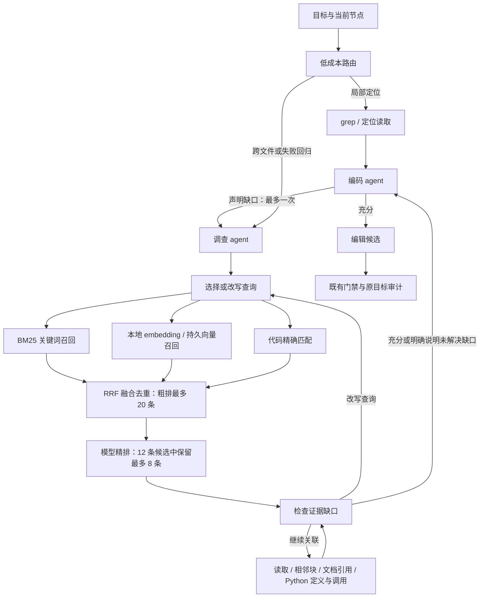

# 按需取证：直接搜索与 Agentic RAG

本文描述当前实现的搜索、召回、排序与调查流程。检索用于辅助决策，不是代码正确性或交付质量保证；项目资料的来源与信任边界见 [项目记忆](agentic-rag.md)。

## 工具选择服务于目标

简单局部任务使用 git grep 和定位读取，不调用额外的调查或精排模型。当前路由依据目标范围、跨文件/根因调查要求和失败反馈；这是可解释规则，仍需真实任务校准。

编码 agent 缺少关键证据时，可以在写入前返回一次 investigate 请求，明确查询和缺口。系统运行只读调查后，把证据交回同一 agent，再接收编辑计划。不能在调查请求里夹带改动，也不能借调查扩大写边界。



## 已接入源码的管线

| 阶段 | 实现 | 限制 |
| --- | --- | --- |
| 结构切片 | Markdown 标题、段落、代码围栏；Python AST 类与函数；长块继续拆分 | 保留 commit、路径、行范围、符号和摘要；其他语言采用文本分块 |
| 关键词召回 | BM25 风格词法检索，中文相邻字对 | 最多 30 条；不补造未命中的资料 |
| 向量召回 | FastEmbed 多语言适配器；SQLite 保存 float32 向量并做精确余弦检索 | 最多 1000 个分块；不是 ANN 引擎，没有部署 Qdrant |
| 代码召回 | git grep 与定位窗口 | 只读已提交版本，整份文件检查后才返回片段 |
| 融合粗排 | RRF，k=60；按来源及相同文本去重 | 保留各路排名与候选，不直接相加不同量纲的原始分数 |
| 语义精排 | 使用现有生成模型判断相关性并返回候选 ID | 看最多 12 条、每条 600 字符，保留最多 8 条；当前不是 cross encoder |
| 调查循环 | search、grep、read、expand、follow_link、symbol、finish | 一次空结果允许换工具；连续两次无新证据则停止 |
| 持久化 | 按仓库/模型隔离，未变文本复用向量，原子替换快照 | 删除时清理项目向量；代数检查阻止删除前的旧快照重新写入 |

向量库只提供候选排序；原文必须重新取自当前项目语料。不存在或跨范围的 ID 会被丢弃。精排伪造 ID、重复 ID 或无效 JSON 时，回退到实际粗排结果。

编码和审查使用的 Python 源码窗口按类与方法联合定位，避免 `Target.normalize` 被其他类的同名方法挤出。审查根据实际 diff 行号补充改动方法的所属类，不依赖 diff hunk 是否展示类名；原有编码 8000、候选审查 3200、依赖审查 1500 字符上限及省略标记不变。这只改善有界上下文的选择，不证明模型能发现未被行为验收覆盖的缺陷，也不扩大读写权限。

向量库位于工作区 `knowledge/.retrieval`，是可重建投影，不改权威事件库 schema。向量文件权限为 0600，只保存向量及摘要；模型标识包含 FastEmbed 包版本和模型名。模型依赖与权重仍属于供应链边界，适配器没有对未来下载强制执行发布者签名校验；部署者应审核下载来源及版本。

## 成本与边界

- 每次调查最多 6 次控制调用、2 次精排调用，每次最多 512 输出 token，计入当前任务共享预算。
- 编码、回归和主动调查阶段还预留后续编辑调用预算；可选检索预算不足时停止并保留已有证据。DeepSeek 的小型检索控制调用使用单独的无思考连接副本，常规角色参数不被改写。
- 简单搜索没有这些额外调用；本地 embedding 不调用收费生成接口。
- 最终参考上下文约束在 6000 字符内。资料和偏好不能覆盖目标、写边界、验收或审批。
- 只跟随当前仓库已提交文件的相对 Markdown 引用。不联网抓取外部链接，不读取符号链接或临时文件。
- 已有引用快照按原保留策略保存；删除资料影响后续上下文，不追溯改写历史审计。

## 网页与启用

知识面板增加准备模型、更新项目索引和关闭语义检索。试查可选直接搜索、词法、混合召回或深查；默认不调用生成模型，勾选后才允许试查的调查和精排。轨迹显示各路候选、排序来源、工具动作和引用。

本地模型为 sentence-transformers/paraphrase-multilingual-MiniLM-L12-v2。准备操作允许下载模型；后续任务只从本地缓存加载。未安装、加载失败和索引异常分别报告，不能用“已配置”代替“已就绪”。

新环境需安装可选依赖，再在网页选择「准备并启用本地语义检索」。该准备过程可能联网下载模型；不要将其描述为完全离线安装：

```sh
.venv/bin/python -m pip install -e '.[retrieval]'
```

新增接口：GET /api/knowledge/retrieval/status、POST /api/knowledge/retrieval/setup、POST /api/knowledge/retrieval/index。既有试查接口增加 hybrid 模式及显式模型许可。知识目录仍需单独备份；安全保存的生成模型凭证通过系统钥匙串恢复，临时连接需要重新填写。

## 维护与限制

离线测试应覆盖 Git / SQLite 投影、来源校验、只读工具、项目隔离、预算耗尽与无效精排输出。可选模型加载与具体平台能力需要部署者单独检查，不能由配置存在推断已经可用。

混合召回不是完备搜索：语料、切片、候选数及上下文窗口均有上限。精排只判断相关性，不证明事实正确；调查停止时可能仍有明确未解决的缺口。没有命中不代表目标代码或风险不存在。

参考：[FastEmbed 支持的模型](https://qdrant.github.io/fastembed/examples/Supported_Models/)、[本地加载实现](https://github.com/qdrant/fastembed/blob/main/fastembed/text/text_embedding.py)、[RRF 与多阶段检索](https://qdrant.tech/documentation/search/hybrid-queries/)。本实现没有部署 Qdrant 服务，也不借用这些工具的基准成绩作为自身效果声明。
